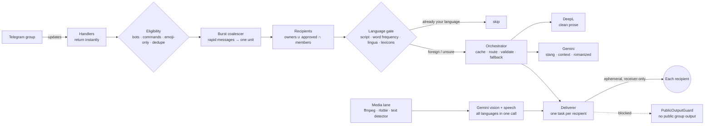

<div align="center">

# 🌐 All-in-One Translator

### The invisible interpreter for Telegram groups

**Everyone chats in their own language. Each approved person privately sees translations in *their* language.
Nobody else sees anything.**

[](https://github.com/gazzy-source/all-in-one-translator/actions/workflows/ci.yml)


</div>

---

## The problem

Multilingual Telegram groups are hard to follow. Existing translator bots solve it by **posting a public
translation under every message**, doubling the chat, notifying everyone, and some even delete members' messages
to "reduce clutter". Telegram's built-in real-time translation requires **Premium for every reader**.

## The solution

All-in-One Translator uses Telegram's newest **ephemeral messages** (Bot API 10.2, 2026). Every translation
appears directly under the original message, **visible only to the person it's for**. The group looks exactly as if
the bot weren't there.

```
What Maria (unapproved member) sees        What you (approved, English) see          What Ravi (approved, Hindi) sees
──────────────────────────────────        ──────────────────────────────────        ─────────────────────────────────
Maria: ¿Alguien sabe si mañana             Maria: ¿Alguien sabe si mañana            Maria: ¿Alguien sabe si mañana
       estará abierto? 😂                         estará abierto? 😂                        estará abierto? 😂
                                             ↳ 🌐 Spanish → English                     ↳ 🌐 Spanish → Hindi
                                               Does anyone know if it'll be              क्या किसी को पता है कि कल
                                               open tomorrow? 😂                         यह खुला रहेगा? 😂
```

## ✨ Features

### Invisible by design
- **Zero public output**: no translations, replies, reactions, "typing…", pins, edits or command menus in the group.
- Enforced in code by **`PublicOutputGuard`**, a request middleware that rejects any Bot API call that would be
  visible in a group *before it is sent*. Tests prove it.
- Hidden owner commands (`/approve`, `/revoke`, `/check`, `/glossary`) are registered only for owners and are
  invisible to everyone else.

### Private, per-person translation
- **Approved recipients:** bot owners, people approved by a bot owner, and people approved by this group's
  admins. Group admins can use hidden `/approveall` for members seen in their group. Membership is checked.
- **Approve and done:** each reader's language is picked automatically (the language they write in the group,
  else their Telegram app language); anyone can choose one of 79 languages with `/language`. Nobody has to
  message the bot first.
- **Only the translation** is shown (no language labels); mixed-language messages and stickers are translated
  in full.
- Translated **once per language** and delivered separately to each person; one person's settings, pause or
  failure never affects another.
- Your own messages are never translated back to you; messages already in your language are skipped.
- **Personal reading preferences:** `/settings` → **I also read** skips confidently identified messages in
  additional languages; mixed or uncertain messages remain eligible. **Show the original** adds a short quote
  above your group translations.
- Consecutive text from the same sender can extend your previous private translation for up to 20 seconds.
  Replies, interruptions, changed language/display preferences, and long output start a fresh bubble.
- Optional, consent-only **private-chat backup** if in-group delivery fails. Never a public fallback.

### Understands real chat
- **Context-aware**: "ni modo" after "are you coming?" → *"oh well"*; replies and recent messages disambiguate.
- **Slang, idioms, sarcasm, emoji**: tone kept at the same strength, laughter localized (jajaja → hahaha).
- **Code-switching & romanized text**: Hinglish ("yaar kya scene hai"), Arabizi ("inta keef"), Spanglish.
- **Native scripts guaranteed**: Hindi in Devanagari, Arabic in Arabic script; wrong-script output is rejected.
- **Names, @mentions, URLs, numbers, prices and times preserved**, validated after every translation.

### Reads media in any script
- **Stickers** (static WEBP), **animated stickers** (TGS/Lottie), **video stickers** (WEBM), **GIFs**, **images
  and memes**, with captions combined.
- **Videos & video notes (≤ 1 min)** and **voice messages**: speech transcribed and translated, plus on-screen text.
- Smart pipeline: textless media costs **zero AI calls**; animated text like "WAIT → WHAT → IS THIS" is read once,
  in order; repeated stickers are served from cache.

### 1:1 translator in a private chat
- Send or forward **any text, sticker, GIF, photo, video or voice note** to the bot → it replies with the translation
  in your language (`English → Hindi` footer). Open to everyone by default (`PRIVATE_ACCESS`), with per-user rate
  limits and a daily cap for users who aren't approved (`PRIVATE_PER_MIN`, `PRIVATE_DAILY_LIMIT`).
- Typing a language name ("Hindi", "español") offers to switch your language instead of translating it.

### Private-chat plan (Telegram Stars)
- Every user gets **1,000 free** private-chat translations (only delivered translations count). Then
  **100 ⭐ for 1,000 more** or **10,000 ⭐ for unlimited, forever** — Telegram Stars, paid inside Telegram.
- Owners, and people the owner grants with `/approvefree`, are free for life and never counted. Group
  translations aren't metered. Payments are validated before charging, credited exactly once, refundable
  (`/refund`), and `/paysupport` reaches the owner. All amounts are configurable (`.env.example`).

### Reply in the group's language, without leaving the group
- Reply **`/tr`** to any message for a translation only you see (works on stickers, GIFs and voice too).
- **`/tr your text`** → your message in the group's language with **Copy** / **Send** buttons. `/tr` is a hidden
  command: nobody else sees it or the answer.
- Type `@your_bot text` in any chat → tap one of the translations (into the languages your groups read) to send
  it. Debounced per keystroke, cached.

### Built to run for free
- **Google Gemini (free tier)** for slang, context, Hinglish and vision/speech; **DeepL API Free** (1M chars/month)
  for clean prose. Smart routing, local quota guards, automatic failover.

## 📊 Results (measured, not claimed)

All numbers from real runs in `benchmarks/` (raw outputs in `benchmarks/results/`).

| Benchmark | What it measures | Result |
|---|---|---|
| **Language gate** (offline, 107 cases) | Unwanted translations / missed translations | **0% / 0%** · 98% source-language accuracy · ~25 ms/msg |
| **Translation** (live, 47 cases, 14 languages) | Errors, silent misses, entity/number preservation | **0 errors · 0% silent misses · 0% entity violations · 100% source-language accuracy** · chrF 77.4 · p50 0.78 s |
| **Language matrix** (live, 12 messages × 6 targets) | Output is in the recipient's language & native script | 100% right language · 0 garbled outputs (PLAN.md L13) |
| **Media** (live, 23 items) | Text/speech recall, false positives, right language | **100% recall · 0% false positives · 0 AI calls on textless media · 100% right language** |
| **Live Telegram acceptance** (3 real accounts) | English reader, Hindi reader, unapproved member | ✅ each approved user got their own translation; unapproved member and group saw nothing |

Media latency (end to end, live): sticker ~2.8 s · GIF ~2.7 s · animated sticker ~3.4 s · video with speech ~3.0 s
· voice ~4.2 s.

## 🧠 How it works



**Key engineering decisions** (details in [ARCHITECTURE.md](ARCHITECTURE.md)):

- **Local three-way language gate** (TARGET / OTHER / UNSURE) instead of calling an AI for every message. Off-the-shelf
  detectors misread short chat ("no manches" → French), so word-frequency evidence, script analysis and Hinglish/Arabizi
  lexicons decide locally; only genuinely uncertain messages (~7%) are decided by the AI in the same call that translates.
- **Free-tier-aware routing**: clean text → DeepL; slang/romanized/mixed/short → Gemini; one escalation on failed
  validation; one fallback hop; circuit breakers; deadlines split so a fallback always has time.
- **Model choice from measurements**: larger free Gemini models took 10–40 s or returned 503, so only flash-lite is
  practical. In a side-by-side test of slang into Russian/Arabic/Hindi, `gemini-3.5-flash-lite` produced word salad
  in 3–5 of ~25 replies and `gemini-3.1-flash-lite` in none, so text uses 3.1 (3.5 as failover) and vision stays on
  3.5. A local "mostly non-words" check (wordfreq) rejects garbled output and falls back to DeepL.
- **Media gate that works for every script**: a script-agnostic text *detector* with an aspect-ratio/recognizer filter
  (the bundled OCR recognizer only knows Latin/CJK, which initially made Hindi/Arabic/Korean stickers look textless).
- **Privacy**: message text is never written to disk or logged; only IDs/hashes (48 h) and shared-asset OCR
  (stickers/GIFs) are stored.

## 🛠 Tech stack

Python 3.12+ · aiogram 3.33 (Bot API 10.4) · asyncio · SQLite (aiosqlite, WAL) · httpx · Google Gemini API · DeepL
API · lingua · wordfreq · RapidOCR (ONNX) · rlottie · ffmpeg · Pillow · pytest · ruff · mypy --strict · bandit ·
pip-audit · Docker

## 🚀 Quick start

```bash
git clone https://github.com/gazzy-source/all-in-one-translator.git
cd all-in-one-translator
python -m venv .venv && . .venv/bin/activate      # Windows: .venv\Scripts\activate
pip install -e ".[media]"
cp .env.example .env                              # BOT_TOKEN, OWNER_IDS, GEMINI_API_KEY and/or DEEPL_API_KEY
python -m translator_bot
```

Requirements: Python 3.12+, `ffmpeg` on PATH (GIFs/video/voice), a bot token from @BotFather, your numeric Telegram
ID, and at least one free API key: [Gemini](https://aistudio.google.com/apikey) and/or
[DeepL API Free](https://www.deepl.com/pro-api). Docker: `docker compose up -d --build`.

**Production:** see [docs/DEPLOYMENT.md](docs/DEPLOYMENT.md) — Docker or systemd on any always-on Linux machine,
published image on GHCR, health checks with self-healing restarts, online backups
(`python -m translator_bot.backup`), updating, webhook mode, free-tier limits and troubleshooting.

### BotFather
1. `/newbot` → token. 2. `/setinline` → enable inline mode. 3. Privacy mode can stay on (admin bots receive all messages).

### Group setup
1. Add the bot and promote it to **admin with every right switched off** (admin status is what allows private
   in-group messages; no rights are needed or used).
2. Whoever adds/promotes the bot gets setup steps privately. New groups are enabled by default
   (`ENABLE_NEW_GROUPS=owner_added` restores owner-only setup).
3. Group admins can reply `/approve` to members or use `/approveall` for people seen in that group.
   A bot owner's approval applies across groups; a group admin's approval applies only there.
4. Readers receive translations in their automatically detected language or Telegram app language.
   They can choose another language with `/language` in private; `/start` is optional.

## 💬 Commands

| Who | Command | Purpose |
|---|---|---|
| Everyone (`PRIVATE_ACCESS=everyone`) | *any message* | Translated into your language, as a reply |
| | `/start` · `/help` | Welcome and short help (role-aware), language picker |
| | `/language` · `/settings` | Change translation language · preferences |
| | `/privacy` · `/forgetme` | What's processed and stored · delete your data |
| Approved recipients | `/groups` | Groups where you receive translations (mute per group) |
| | `/pause` · `/resume` | Stop/restart your group translations |
| Everyone | `/buy` · `/paysupport` | Private-chat plan (Telegram Stars) · payment help |
| Owners (private) | `/approve <id>` · `/revoke <id>` · `/recipients` | Manage recipients |
| | `/approvefree <id>` · `/revokefree <id>` | Free private chat for life (separate from `/approve`) |
| | `/refund <payment id>` | Refund a Stars payment and remove what it unlocked |
| | `/chats` | Per-group toggles: text, captions, images, stickers, animated, GIFs, videos, voice, context, sender name |
| | `/status` | Health, delivery counters, provider quota, latency |
| Owners (hidden, in group) | `/approve` · `/revoke` · `/approvefree` · `/revokefree` (as replies) · `/check` · `/glossary term = rendering` | Invisible to members |
| Group admins (hidden, in their group) | `/approve` · `/revoke` · `/approveall` · `/revokeall` · `/glossary` | Manage this group's readers and glossary |

Group translations need bot-owner approval, group-admin approval, or that group's `/approveall` (with
`PRIVATE_ACCESS=approved` the whole private chat is limited to approved users).

## 🔒 Privacy & security

- Group members never see bot output; translations are receiver-only Telegram ephemeral messages.
- No message text on disk or in logs; photos, videos and voice are processed in memory and discarded.
- Prompt-injection safe: messages are passed as data and never followed; output is sanitized HTML.
- Media sandboxing: size/duration caps, decompression- and gzip-bomb guards, ffmpeg without shell, worker processes
  recycled on hang.
- Full review: [SECURITY.md](SECURITY.md). Static analysis: ruff (incl. security rules), mypy strict, bandit, pip-audit.

## 🧪 Testing

- **380+ automated tests** including end-to-end runs through the real aiogram dispatcher against a recording fake
  Telegram (asserting zero public group output), provider adapters against recorded API shapes, and media tests with
  real ffmpeg/rlottie/OCR on generated fixtures.
- **Live benchmarks**: `benchmarks/bench_translation.py`, `bench_language_matrix.py`, `bench_media.py`,
  `bench_detection.py`.
- **Live Telegram probes**: `scripts/live_probe.py`, `scripts/provider_smoke.py`.

```bash
pip install -e ".[media,dev]"
pytest && ruff check src tests && mypy && bandit -c pyproject.toml -r src
```

## ⚠️ Honest limitations

- Telegram documents ephemeral messages as best-effort: they may not reach a user who is offline and may disappear
  later. The API can report success anyway.
- Telegram sends bots no deletion events in groups, so translations of deleted messages are not removed.
- Adding the bot creates Telegram's standard "added the bot" service message; the bot appears in the member list.
- Free-tier AI providers may use submitted text to improve their services.
- Very stylized single-glyph stickers are an edge case for the local text detector.

## 🗺 Roadmap

Per-topic target languages · PDF/document text · longer videos via the Files API · per-group usage dashboards ·
optional paid-tier providers with no-training terms.

## 📁 Repository guide

| Path | What's inside |
|---|---|
| `src/translator_bot/` | Bot source (pipeline, providers, media, delivery, guard, UI) |
| `tests/` | Unit, end-to-end and media tests |
| `benchmarks/` | Corpora, benchmark runners and live results |
| `scripts/` | Live Telegram and provider probes |
| [ARCHITECTURE.md](ARCHITECTURE.md) | Design, data flow, decisions, cost model |
| [docs/DEPLOYMENT.md](docs/DEPLOYMENT.md) | Production deployment, backups, updates, troubleshooting |
| [COMPETITIVE_ANALYSIS.md](COMPETITIVE_ANALYSIS.md) | Comparison with existing translator bots |
| [SECURITY.md](SECURITY.md) | Security review |
| [PLAN.md](PLAN.md) | Status and live-verification log |
| [CHANGELOG.md](CHANGELOG.md) | Release notes |
| [CONTRIBUTING.md](CONTRIBUTING.md) · [CODE_OF_CONDUCT.md](CODE_OF_CONDUCT.md) | How to contribute |
| [AGENTS.md](AGENTS.md) | Repository rules for coding agents |

---

<div align="center">
MIT License
</div>
